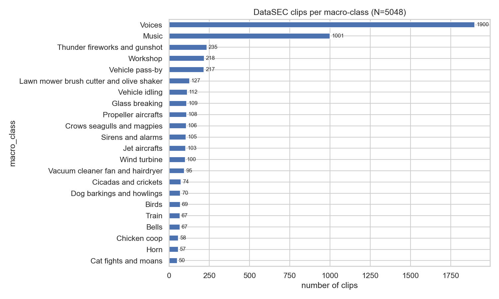
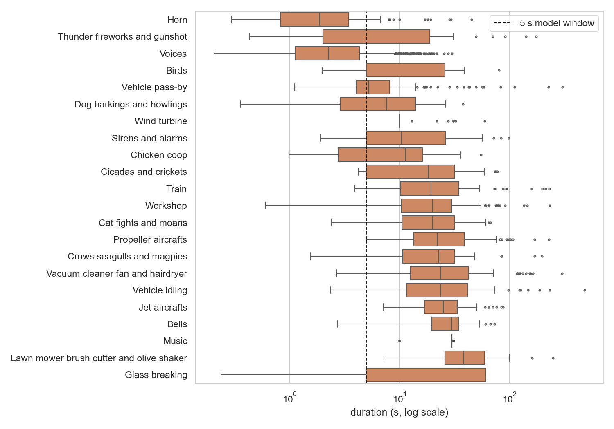
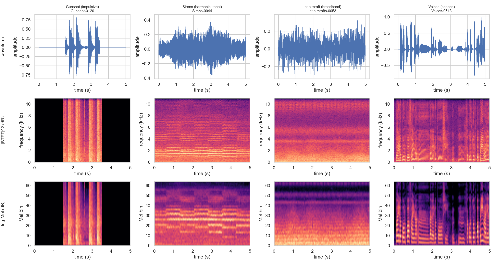
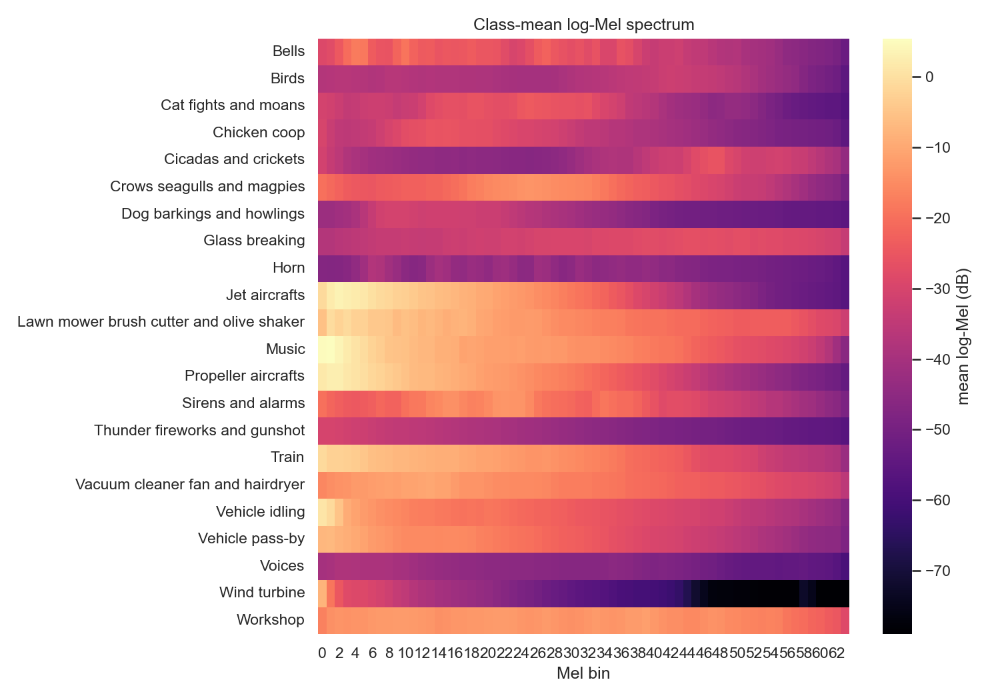
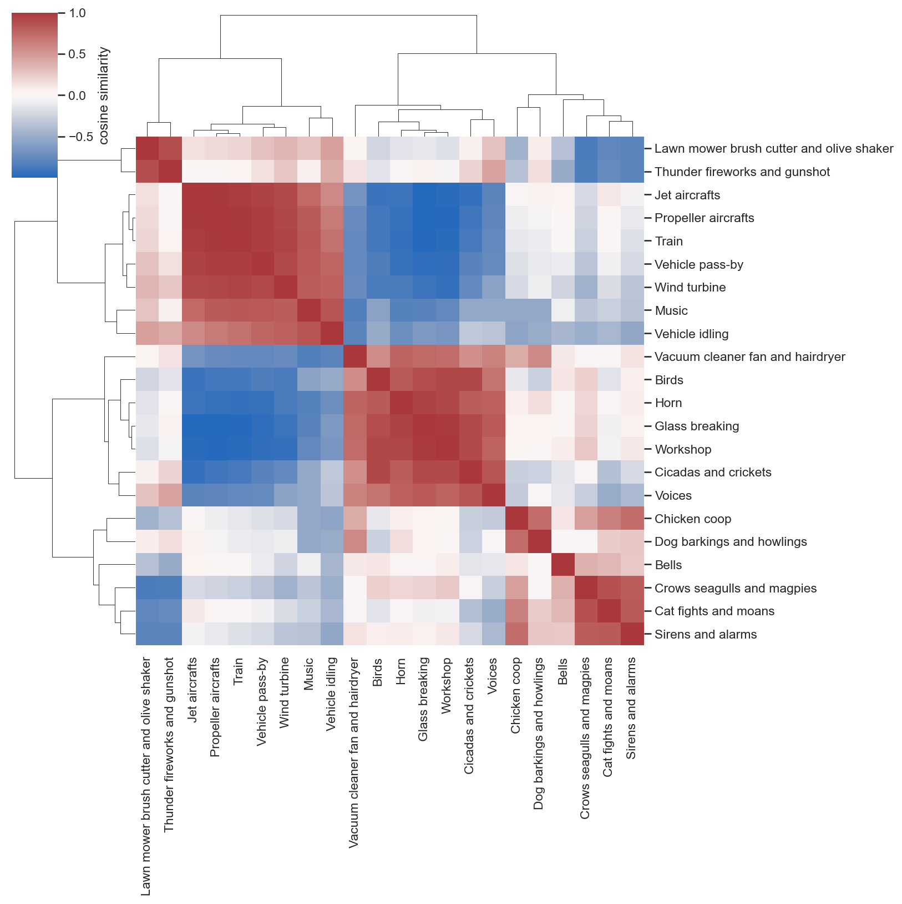
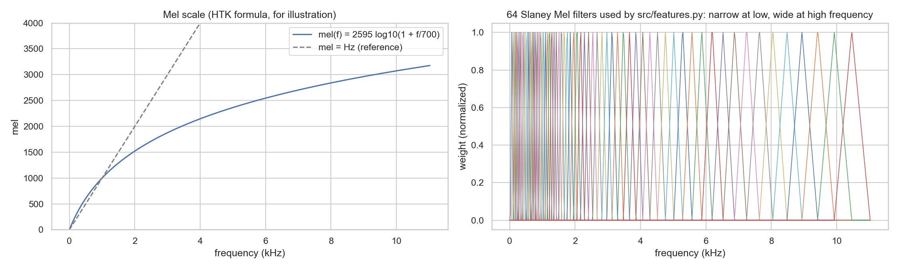
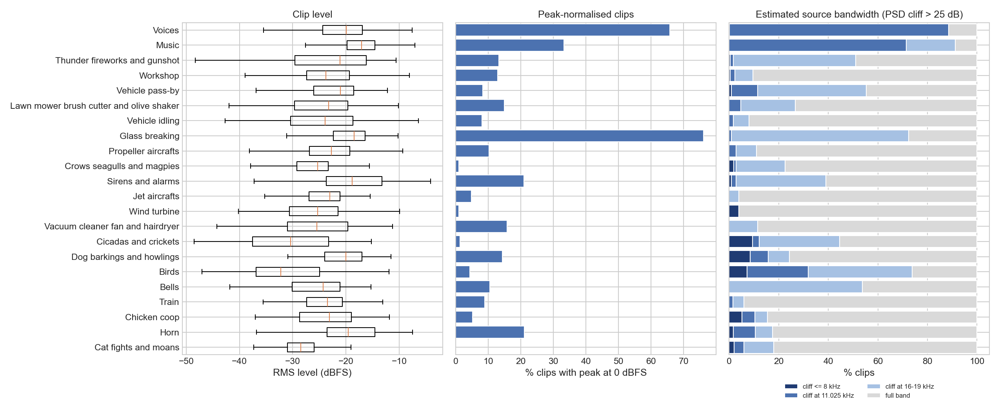

# Dataset analysis (Midterm part A)

All numbers, figures and tables below are produced by [`scripts/eda.py`](../scripts/eda.py) from the pinned
release (Zenodo DOI [10.5281/zenodo.17033970](https://doi.org/10.5281/zenodo.17033970)). Run it after
`download_data.py` and `build_index.py`; outputs go to `results/figures/eda_*.png` and `results/tables/eda_*.csv`.

## A1. Clip count and class distribution

| | value |
|---|---|
| clips | **5,048** WAV files |
| total duration | 23.71 h |
| classes | 22 macro-classes; 10 of them split into 28 subclasses, giving 40 leaf classes |
| format | 44.1 kHz, mono, PCM |

The pinned Zenodo archive contains 5,048 clips / ~23.7 h, more than the 4,292 clips / 18 h 26 min quoted in the
brief (and in v1 of the paper). We use the DOI-pinned archive as required and report the difference.

Subclass counts: [`eda_subclass_counts.csv`](../results/tables/eda_subclass_counts.csv).

## A2. Duration statistics per class

Full table (count, min, max, mean, median, total hours): [`eda_duration_stats.csv`](../results/tables/eda_duration_stats.csv).

| class | n | min (s) | max (s) | mean (s) | median (s) |
|---|---:|---:|---:|---:|---:|
| Horn | 57 | 0.29 | 45.20 | 4.94 | 1.88 |
| Thunder fireworks and gunshot | 235 | 0.43 | 174.61 | 9.74 | 2.00 |
| Voices | 1900 | 0.20 | 29.94 | 3.19 | 2.24 |
| Birds | 69 | 1.97 | 79.97 | 13.16 | 5.00 |
| Vehicle pass-by | 217 | 1.11 | 303.14 | 10.78 | 5.27 |
| Dog barkings and howlings | 70 | 0.35 | 37.74 | 9.61 | 7.56 |
| Wind turbine | 100 | 10.00 | 59.34 | 11.46 | 10.00 |
| Sirens and alarms | 105 | 1.91 | 99.07 | 18.15 | 10.38 |
| Chicken coop | 58 | 0.98 | 55.14 | 11.95 | 11.30 |
| Cicadas and crickets | 74 | 4.22 | 77.37 | 22.86 | 18.20 |
| Train | 67 | 3.89 | 230.14 | 35.17 | 19.38 |
| Workshop | 218 | 0.60 | 233.44 | 25.02 | 19.95 |
| Cat fights and moans | 50 | 2.39 | 66.97 | 23.41 | 19.97 |
| Propeller aircrafts | 108 | 5.04 | 228.14 | 33.80 | 22.04 |
| Crows seagulls and magpies | 106 | 1.55 | 198.37 | 25.52 | 22.75 |
| Vacuum cleaner fan and hairdryer | 95 | 2.66 | 301.00 | 38.54 | 23.46 |
| Vehicle idling | 112 | 2.35 | 481.48 | 36.81 | 23.55 |
| Jet aircrafts | 103 | 7.15 | 87.28 | 27.83 | 24.91 |
| Bells | 67 | 2.71 | 73.08 | 28.59 | 29.64 |
| Music | 1001 | 10.00 | 30.65 | 29.98 | 30.00 |
| Lawn mower brush cutter and olive shaker | 127 | 7.23 | 248.87 | 43.01 | 38.40 |
| Glass breaking | 109 | 0.24 | 60.53 | 36.64 | 60.52 |

- Durations range from 0.2 s to 8 min, and medians differ strongly between classes (Horn / Voices ~2 s,
  Music 30 s, Glass breaking 60 s).
- With the 5 s model window, **38.3 %** of clips are zero-padded and **60.0 %** are cropped.
- **Duration is a shortcut cue.** A gradient-boosting classifier that sees only log(duration) reaches
  macro-F1 **0.272 ± 0.008** (5-fold CV) against 0.045 for chance. A model could partly learn the length of the padding
  instead of the sound. This is a limitation we keep in mind when analysing errors.

## A3–A4. Waveform, linear spectrogram and log-Mel of contrasting classes

Four physically different sound types, each shown as the most energetic 5 s window of one clip:
**Gunshot** (impulsive), **Sirens** (harmonic, tonal), **Jet aircraft** (broadband), **Voices** (speech).
Row 2 is the linear-frequency power spectrogram |STFT|² in dB (0–11.025 kHz). Row 3 is the 64-band log-Mel that
the networks actually receive, computed by the same `src/features.py` module used during training.

- The **waveform** only shows *when* the sound is loud. Gunshot appears as sharp spikes, the jet as a dense uniform
  block, the siren as a nearly flat envelope. Its frequency content cannot be read from it.
- The **linear spectrogram** separates frequencies. The gunshot gives vertical lines (all frequencies at once, very
  short), the siren horizontal or curved lines (harmonics), the jet a wide bright band. Most of the image height,
  however, is spent on frequencies above 4 kHz.
- The **log-Mel** stretches the low frequencies and compresses the high ones (513 linear bins → 64 Mel bands), so the
  siren harmonics and the jet's low-frequency energy take more of the image while the input is 8× smaller.
  The network input is a 1 × 64 × 216 image.

## A5. Class balance

| | value |
|---|---|
| largest / smallest class | Voices 1,900 / Cat fights and moans 50 = **38×** |
| two largest classes (Voices, Music) | 57.5 % of all clips |
| normalized class entropy | 0.738 (1.0 = perfectly balanced) |

Predicting "Voices" for every test clip already gives accuracy 0.376 but macro-F1 only 0.025, so accuracy alone is
misleading. The project handles the imbalance in three ways:

1. **Macro-F1 is the main metric** (every class counts equally) and is used for checkpoint selection on validation.
2. **Class-weighted cross-entropy** with inverse-frequency weights on the train split, normalized to mean 1
   (e.g. Cat 1.99, Voices 0.05; `src/data.py::class_weights`).
3. **Stratified split on the 40 leaf classes**, so even the smallest class keeps 34 / 8 / 8 clips in
   train / val / test (`splits/split_meta.json`).

## A6. Classes with overlapping spectral envelopes

For each class we average the time-averaged log-Mel spectrum of up to 40 random clips, giving a 64-dimensional
spectral signature. All classes share a steep low-frequency tilt, so before comparing them we subtract each class's
mean level and the cross-class mean signature, then compute cosine similarity.

Most similar pairs ([`eda_similar_pairs.csv`](../results/tables/eda_similar_pairs.csv)):

| class A | class B | cosine |
|---|---|---:|
| Jet aircrafts | Propeller aircrafts | 0.992 |
| Propeller aircrafts | Train | 0.988 |
| Glass breaking | Workshop | 0.982 |
| Jet aircrafts | Train | 0.976 |
| Train | Vehicle pass-by | 0.964 |
| Propeller aircrafts | Vehicle pass-by | 0.963 |
| Glass breaking | Horn | 0.942 |
| Jet aircrafts | Vehicle pass-by | 0.939 |
| Train | Wind turbine | 0.932 |
| Horn | Workshop | 0.927 |

The pairs form two clusters:
- **vehicles and engines** (Jet, Propeller, Train, Vehicle pass-by): long, broadband, low-frequency energy;
- **bright, sharp sounds** (Glass breaking, Workshop, Horn).

These are hypotheses about likely confusions. The per-class F1 and confusion matrices of the trained baselines
(`results/figures/test_per_class_f1.png`, `results/figures/confusion_*.png`) confirm that the hardest classes are in
the vehicle / engine / machinery group.

## A7. Waveform vs. linear spectrogram vs. log-Mel

**1. Raw waveform** $x[n]$: acoustic pressure sampled in time ($f_s$ = 22,050 samples/s after resampling).
Physically, it is the air-pressure oscillation picked up by the microphone. It has no explicit frequency axis and is
phase-sensitive: shifting the same sound by a few samples changes the curve completely although it sounds identical.

**2. Linear-frequency (power) spectrogram.** The signal is cut into short overlapping frames with a Hann window $w$,
and each frame is Fourier-transformed:

$$X[m,k] = \sum_{n} x[n]\, w[n - mH]\, e^{-j 2\pi k n / N}, \qquad S[m,k] = |X[m,k]|^2$$

$m$ is the frame index (hop $H = 512$ samples ≈ 23 ms) and $k$ the frequency bin. With $N = 1024$ there are
$N/2 + 1 = 513$ bins spaced uniformly by $f_s / N \approx 21.5$ Hz. Squaring the magnitude gives energy and discards
the phase, so the representation is more stable than the waveform. The frame length sets a time–frequency trade-off:
longer frames give finer frequency resolution and coarser time resolution, and vice versa.

**3. log-Mel spectrogram.** The 513 bins are pooled by $B = 64$ triangular filters $H_b$ spaced uniformly on the Mel
scale, then compressed logarithmically:

$$\mathrm{mel}(f) = 2595 \log_{10}\!\left(1 + \frac{f}{700}\right), \qquad
M[m,b] = 10 \log_{10}\!\Big(\sum_k H_b[k]\, S[m,k] + \varepsilon\Big)$$

- The Mel scale is roughly linear below ~1 kHz and logarithmic above, like human pitch perception: 100 Hz vs.
  200 Hz is far easier to tell apart than 8,100 Hz vs. 8,200 Hz. The filters are therefore narrow at low frequency
  (first filter ≈ 86 Hz wide) and wide at high frequency (last filter ≈ 1,077 Hz wide).
- The **logarithm** compresses the huge dynamic range (an explosion carries thousands of times more energy than a
  cricket), matching the roughly logarithmic perception of loudness, and turns a **gain change into an additive
  constant**. This is relevant to the gain perturbations in the Final.
- The formula above is the common HTK form. The project uses the **Slaney** variant (linear below 1 kHz, logarithmic
  above; same idea), with an 80 dB floor below each clip's peak and train-set mean/std normalization.

## A8. Data quality and curation artefacts

The checks in this section are produced by [`scripts/eda_quality.py`](../scripts/eda_quality.py) and
[`scripts/leakage_sensitivity.py`](../scripts/leakage_sensitivity.py). They describe how DataSEC was assembled, not
how the sounds behave, and a model can pick them up as shortcuts.

### Clips that share audio

[`eda_overlap_pairs.csv`](../results/tables/eda_overlap_pairs.csv) lists **24 pairs** of clips that share audio:

| Relation | Pairs | Examples |
|---|---:|---|
| Identical file (md5) | 16 | 14 in Music |
| Shorter clip is an exact prefix of the longer one | 5 | e.g. Dog barkings-0042 inside Dog barkings-0002 |
| Same first seconds | 3 | e.g. Olive shaker-0014/0015 share 4.8 s |

The fixed split groups only the identical files, so two pairs cross partitions:

- `Crows-0017` (test) is the first 33.9 s of `Crows-0016` (train);
- `Olive shaker-0015` (test) shares its first 4.8 s with `Olive shaker-0014` (train).

The split is **not** regenerated, because it is fixed for the Midterm and must be reused for the Final. Instead,
[`midterm_leakage_sensitivity.csv`](../results/tables/midterm_leakage_sensitivity.csv) re-scores the saved test
predictions without these two clips:

| Model | Test macro-F1, all 758 clips | Without the 2 clips | Change |
|---|---:|---:|---:|
| `small_cnn` | 0.8841 | 0.8833 | −0.0008 |
| `mobilenetv3s` | 0.8531 | 0.8544 | +0.0013 |
| `crnn` | 0.8154 | 0.8168 | +0.0014 |

The change is at most 0.0014, so the leak does not affect the model ranking. It is reported as a limitation.

There is also no recording/session ID in the metadata. Segments cut from one long recording that do *not* share their
first second cannot be detected, so test scores may still be slightly optimistic.

### Curation artefacts per class

Summary table: [`eda_signal_quality.csv`](../results/tables/eda_signal_quality.csv).

- **Source bandwidth.** 88 % of Voices clips and 72 % of Music clips have a hard spectral cliff at **11.025 kHz**:
  they were 22.05 kHz audio before being upsampled to 44.1 kHz. Most field-recording classes extend to 16–22 kHz.
  At 44.1 kHz a model could recognise Voices and Music by "no energy above 11 kHz". The 22.05 kHz pipeline removes
  this cue, because every clip is then band-limited at the same Nyquist frequency.
- **High-frequency energy.** 23 % of clips have more than 1 % of their energy above 8 kHz, and 10 % above
  11.025 kHz. For Glass breaking the median share above 8 kHz is 24 %. Resampling to 16 kHz would discard part of
  these classes, which supports the 22.05 kHz choice.
- **Peak normalisation differs by class.** The share of clips peaking at 0 dBFS is 76 % for Glass breaking and 66 %
  for Voices, against ≤ 1 % for Crows, Cicadas, Wind turbine and Cat fights. Absolute level therefore correlates with
  the class because of curation, not acoustics.
  - The pipeline keeps level information: its per-clip 80 dB floor is relative, and normalisation is global.
  - This makes the Final's gain perturbations a real test of whether the models rely on level.
- **Fixed-length segments.**
  - 93 % of Wind turbine clips are exactly 10.0 s.
  - 56 % of Glass breaking clips are exactly 60.5 s.
  - 96 % of Music clips are 30 s.

  This suggests that these classes come from a few long recordings cut into equal pieces. Wind turbine is also
  unusually homogeneous: its median peak is −15 dBFS and nearly all energy lies below about 200 Hz. Its near-perfect
  test F1 (0.97) may reflect this homogeneity more than generalisation.
