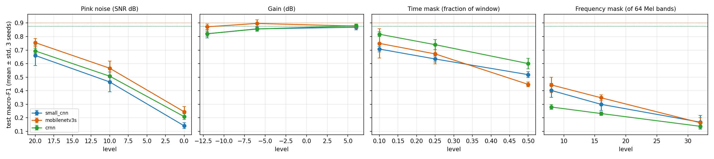
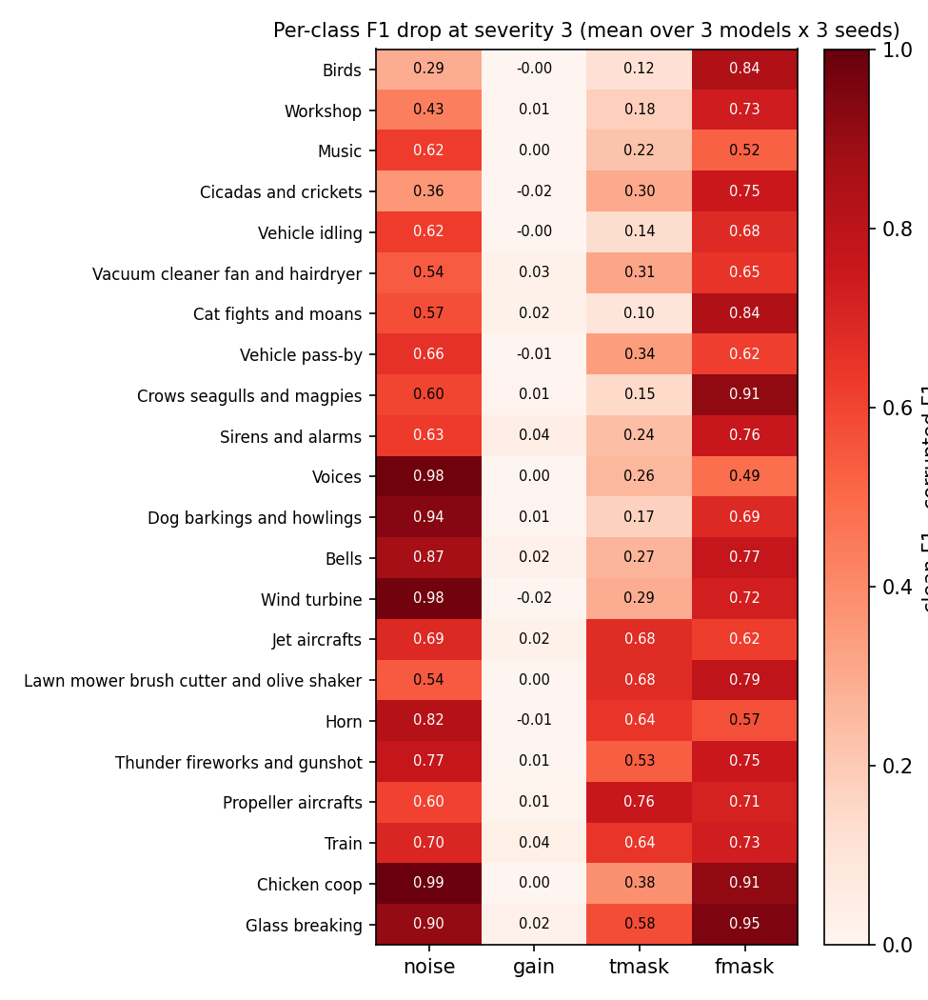

# Robustness of Environmental Sound Classifiers to Test-Time Acoustic Corruptions on DataSEC

ATI Course Project 2026, Track 3 (DataSEC). Every number below is produced by the scripts listed in
[Reproducibility](#9-reproducibility); the corresponding CSV files are in `results/tables/`.

## Abstract

We ask how much three compact log-Mel classifiers (a small CNN, an ImageNet-pretrained MobileNetV3-Small and a CRNN)
lose when the fixed clean DataSEC test set is corrupted at evaluation time. Models were trained once on clean data
with three seeds and evaluated under four corruption types at three severities each (pink noise at +20/+10/0 dB SNR,
gain of −12/−6/+6 dB, time masking of 10/25/50 % of the window, Mel-band masking of 8/16/32 of 64 bands). On the
clean test set the three models are statistically indistinguishable (macro-F1 0.876 ± 0.015, 0.901 ± 0.027,
0.875 ± 0.011). Under corruption, additive noise and band masking are catastrophic for all of them (macro-F1 falls to
0.14–0.25 at 0 dB SNR and to 0.14–0.17 with 32 masked bands), whereas gain changes of up to ±12 dB cost at most
0.056. Time masking separates the models: the CRNN loses 0.275 macro-F1 at 50 % masking against 0.357 for the small
CNN and 0.454 for MobileNetV3-Small (paired bootstrap 95 % CIs exclude zero). Noise-corrupted clips are mostly
predicted as engine-like classes (Train, Vehicle idling). We discuss confounds (different front ends, duration
shortcuts, unrealistically hard zero-masks) and do not claim that recurrence causes the time-masking advantage.

## 1. Introduction

Sound event classification benchmarks are usually evaluated on clean, curated clips, while deployed systems hear
background noise, level changes and dropouts. RQ1 of the project brief asks: *How robust are environmental sound
classifiers when the target sound is perturbed by realistic acoustic noise, temporal distortions and spectral
corruptions?* We answer it with a controlled design: models, split and features are fixed from the Midterm, and only the
test input changes. Section 7 reports which of the hypotheses we wrote down before running the corruptions
(`docs/final_rq_proposal.md`) were supported.

## 2. Data

DataSEC (Fredianelli et al., 2025), Zenodo DOI 10.5281/zenodo.17033970, pinned. The archive has 5,048 mono 44.1 kHz
clips (23.7 h), 22 macro-classes, more than the 4,292 clips quoted in the brief. Class imbalance is 38:1 (Voices 1,900,
Cat fights 50). The split is stratified on 40 leaf classes, 70/15/15, fixed in `splits/`; the test set has 758 clips.
Two test clips share audio with train clips (a prefix and a 4.8 s shared start); removing them changes test macro-F1 by
at most 0.0017 for every model and seed (`midterm_leakage_sensitivity.csv`). Raw audio is not redistributed (licence
CC-BY-NC-SA-4.0). Dataset analysis, including curation artefacts, is in `docs/dataset_analysis.md`.

## 3. Method

**Features (runtime, never stored).** wav → resample to 22.05 kHz → centre crop or zero-pad to 5 s → STFT (n_fft 1024,
hop 512, Hann) → 64 Slaney Mel bands (20 Hz–11.025 kHz) → 10·log10 with an 80 dB floor below each clip's peak →
standardisation with train-set mean and std. Input: 1 × 64 × 216.

**Models.** `small_cnn` (0.39 M parameters, 198 M MACs), `mobilenetv3s` (1.54 M, 18 M, ImageNet weights, one channel
replicated to three) and `crnn` (0.87 M, 487 M, four conv blocks → BiGRU(128)). Training: AdamW, cosine schedule with
warm-up, class-weighted cross-entropy, early stopping on validation macro-F1 (patience 8). Seeds 42, 43, 44. No
augmentation, so no corruption is seen in training.

**Corruptions (test time only; `src/perturb.py`, parameters in `configs/default.yaml`).**

| type | where applied | severities 1/2/3 | definition |
|---|---|---|---|
| noise | 22.05 kHz waveform | SNR +20 / +10 / 0 dB | pink (1/f) Gaussian noise over the whole window; SNR measured against the clip's own span, not the zero padding |
| gain | waveform | −12 / −6 / +6 dB | scaling, no clipping |
| tmask | waveform | 10 / 25 / 50 % of the window | one contiguous segment set to 0 at a random position |
| fmask | Mel power, before the log | 8 / 16 / 32 of 64 bands | one contiguous block of bands set to 0 power |

Each corruption is seeded by `crc32(sample_id, type, level)`, so every model and seed sees identical corrupted inputs
and comparisons are paired. The corruption levels were fixed before any corrupted result was computed, and no
checkpoint, hyper-parameter or corruption level was chosen using test results.

**Metrics.** Macro-F1 (primary: Voices and Music make up 57 % of clips), top-1 accuracy, per-class F1,
ΔF1 = F1<sub>clean</sub> − F1<sub>corrupted</sub> (mean ± std over the three seeds, std with ddof = 1), confusion
changes, and paired bootstrap 95 % CIs (1,000 resamples of the 758 test clips, same resample for all models, ΔF1
averaged over seeds) for differences in ΔF1 between models.

## 4. Experiments

3 models × 3 seeds × (1 clean + 12 corrupted) = 117 evaluations of the same 758 test clips. Prediction-level outputs
(`sample_id, true_class, pred_class, probabilities, duration, model, split, perturbation, severity, seed`) are in
`results/predictions/`; severity 0 is the clean set. Hardware: one NVIDIA GeForce RTX 2060 SUPER (8 GB), Windows 11,
Python 3.13.9, torch 2.14.0+cu126, torchvision 0.29.1, torchaudio 2.11.0, scikit-learn 1.7.2.

## 5. Results

### 5.1 Clean baselines (3 seeds)

| model | val macro-F1 | test acc | test macro-F1 | params | MACs | latency (ms, batch 1, RTX 2060 SUPER) |
|---|---:|---:|---:|---:|---:|---:|
| small_cnn | 0.852 ± 0.011 | 0.931 ± 0.012 | 0.876 ± 0.015 | 0.39 M | 198 M | 1.18 |
| mobilenetv3s | 0.878 ± 0.005 | 0.949 ± 0.016 | 0.901 ± 0.027 | 1.54 M | 18 M | 6.88 |
| crnn | 0.882 ± 0.012 | 0.931 ± 0.005 | 0.875 ± 0.011 | 0.87 M | 487 M | 1.47 |

With three seeds the three models are not separated on clean data. The single-seed Colab Midterm run ranked
`small_cnn` (0.884) > `mobilenetv3s` (0.853) > `crnn` (0.815); that ranking does not survive replication. The difference is
mostly the CRNN: the Colab run stopped early at epoch 20 (best epoch 12), while all local CRNN runs trained 40–50
epochs (best epoch 32–46). Seed-to-seed standard deviation (up to 0.027) is as large as the model gaps.

### 5.2 Degradation under corruption



Mean macro-F1 under severity 3 (full table with all severities and stds: `rq1_delta_f1.csv`):

| corruption (severity 3) | small_cnn | mobilenetv3s | crnn |
|---|---:|---:|---:|
| clean | 0.876 | 0.901 | 0.875 |
| noise 0 dB SNR | 0.141 (Δ 0.735 ± 0.011) | 0.245 (Δ 0.656 ± 0.014) | 0.209 (Δ 0.666 ± 0.024) |
| gain +6 dB | 0.869 (Δ 0.007 ± 0.005) | 0.877 (Δ 0.024 ± 0.012) | 0.880 (Δ −0.005 ± 0.008) |
| time mask 50 % | 0.519 (Δ 0.357 ± 0.023) | 0.447 (Δ 0.454 ± 0.013) | 0.601 (Δ 0.275 ± 0.031) |
| band mask 32/64 | 0.168 (Δ 0.708 ± 0.061) | 0.164 (Δ 0.738 ± 0.044) | 0.137 (Δ 0.738 ± 0.013) |

At severity 1: noise +20 dB already costs 0.15–0.22; gain −12 dB costs 0.03–0.06; time mask 10 % costs 0.06
(CRNN) to 0.17 (small CNN); 8 masked bands cost 0.46–0.60.

**Paired bootstrap, ΔF1 differences at severity 3** (a − b; positive means a degrades more; `rq1_bootstrap.csv`):

| corruption | a − b | mean | 95 % CI | excludes 0 |
|---|---|---:|---|:---:|
| noise | small_cnn − mobilenetv3s | 0.081 | [0.040, 0.121] | yes |
| noise | small_cnn − crnn | 0.069 | [0.030, 0.105] | yes |
| noise | mobilenetv3s − crnn | −0.012 | [−0.055, 0.032] | no |
| time mask | small_cnn − mobilenetv3s | −0.098 | [−0.140, −0.056] | yes |
| time mask | small_cnn − crnn | 0.083 | [0.047, 0.119] | yes |
| time mask | mobilenetv3s − crnn | 0.181 | [0.144, 0.220] | yes |
| band mask | all three pairs | −0.028 … −0.001 | all include 0 | no |
| gain | small_cnn − crnn, small_cnn − mobilenetv3s | 0.013, −0.017 | include 0 | no |

The bootstrap resamples test clips only; the three seeds are averaged inside each resample, so it does not capture
retraining variance beyond what the three seeds provide.

### 5.3 Per-class degradation



ΔF1 per class at severity 3, averaged over models and seeds (`rq1_per_class_delta.csv`):

- **Noise:** the largest drops are for Chicken coop (0.99), Voices (0.98) and Wind turbine (0.98); the smallest for
  Birds (0.29), Cicadas and crickets (0.36) and Workshop (0.43).
- **Time mask:** largest for Propeller aircrafts (0.76), Jet aircrafts (0.68) and Lawn mower (0.68); smallest for Cat
  fights (0.10), Birds (0.12) and Vehicle idling (0.14).
- **Band mask:** largest for Glass breaking (0.95), Chicken coop (0.91) and Crows (0.91); smallest for Voices (0.49),
  Music (0.52) and Horn (0.57).
- **Gain:** no class loses more than 0.04.

Per-class values rest on 8–17 test clips for most classes, so differences of a few tenths between neighbouring
classes are not meaningful; the contrasts above are large.

### 5.4 Confusion transitions and flipped clips

Average extra clips per run moving from true class → predicted class, clean → severity 3
(`rq1_confusion_shift.csv`, figures `rq1_confusion_shift_*.png`):

| corruption | largest shifts |
|---|---|
| noise | Voices → Train (+149 of 285), Music → Train (+60), Voices → Vehicle idling (+57) |
| time mask | Voices → Glass breaking (+63), Voices → Horn (+22), Music → Voices (+19) |
| band mask | Voices → Music (+53), Voices → Dog barkings (+28), Voices → Birds (+22) |
| gain | at most +1 clip per run |

`rq1_flips.csv` lists, for each model and condition, the clips that every seed of the model classifies correctly on
the clean set and wrongly under the corruption (at severity 3: noise 403–579 clips, band mask 323–357, time mask
162–209, gain 0–2 per model). **No listening check has been done by us yet**; the acoustic explanations in Section 6
are hypotheses until someone listens to the corrupted audio (it can be regenerated from `src/perturb.py` and the
cache).

### 5.5 Time masking by clip duration

For time masking at severity 3, ΔF1 is 0.19–0.28 for clips of at most 5 s (n = 309, zero-padded) and 0.21–0.39 for longer
clips (n = 449) (`rq1_duration_split.csv`). The CRNN's advantage is clear on long clips (0.205 vs 0.287 for the small CNN and
0.388 for MobileNetV3-Small) and small on short ones.

### 5.6 Accuracy–efficiency (extension RQ4)

`rq4_pareto.csv`, `rq4_pareto.png`. Mean macro-F1 over the 12 corrupted conditions: small_cnn 0.545, mobilenetv3s 0.586,
crnn 0.564 (clean 0.876 / 0.901 / 0.875).

- On latency and parameter count, `small_cnn` and `mobilenetv3s` are on the Pareto front for clean F1 and the CRNN is
  dominated; for corrupted F1 all three lie on the latency and parameter fronts.
- On MACs only `mobilenetv3s` is on the front (18 M, the highest F1 on both clean and corrupted data).
- Training time differs by less than one minute (3.0–3.7 min), and is affected by early stopping.
- Peak VRAM was not measured, so the VRAM axis requested by the brief is missing.
- Latency was measured on an RTX 2060 SUPER, not the T4 used for the Midterm, and is not comparable with the earlier
  Colab figures.

## 6. Discussion

**Noise and band masking, not level, are the weak point.** All models were trained on clean audio only. Pink noise at
+20 dB SNR already removes 0.15–0.22 macro-F1, and at 0 dB the models predict mostly engine-like classes (Train,
Vehicle idling). One plausible reading is that broadband low-frequency noise resembles those classes' spectra
(Section A6 of the dataset analysis groups them as broadband and low-frequency); this was not tested with
spectrum-matched controls. Masking 8 of 64 Mel bands (12.5 % of the spectrum) costs 0.46–0.60. The zeroed bands drop to
the clip's 80 dB floor, a pattern the models never saw; the result measures sensitivity to such holes, not to realistic
spectral occlusion, and it should not be read as a typical real-world failure rate.

**The models do not rely on absolute level.** Gain of −12 to +6 dB changes macro-F1 by at most 0.056, even though level
correlates with class through curation (dataset analysis A8). Within this range there is no evidence of a level
shortcut; larger gains and clipping were not tested.

**Time masking differentiates the architectures.** The CRNN degrades least, MobileNetV3-Small most, and the
differences in ΔF1 have bootstrap CIs excluding zero. Because the CRNN and the small CNN differ in front end (487 M vs
198 M MACs), pooling and training length, this cannot be attributed to the GRU. The controlled variant (small-CNN
trunk plus BiGRU) was not run.

**Which classes suffer.** Contrary to what we expected, the classes most hurt by time masking are the long, steady
engine sounds (Propeller, Jet, Lawn mower), not the short impulsive ones (Cat fights, Birds are least hurt). A possible
explanation, not tested, is that these classes are almost never zero-padded in training (most clips are longer than
5 s), so a zeroed segment looks like an unfamiliar "silence" cue, whereas short classes always contain padding. The
duration shortcut documented in the dataset analysis (duration-only macro-F1 0.272) makes this plausible but it
requires a padding-aware control to confirm.

**Hypotheses stated before the experiments** (`docs/final_rq_proposal.md`):

| | hypothesis | outcome |
|---|---|---|
| H1 | noise hurts the low-frequency broadband group most | **Not supported.** Noise hurts high-F1 classes (Voices, Chicken coop, Wind turbine) most; Birds, Cicadas and Workshop least. The engine classes are the *destination* of the errors |
| H2 | time masking hurts short impulsive classes most | **Not supported.** The opposite pattern: long steady classes lose most |
| H3 | band masking hurts harmonic / narrow-band classes (Sirens, Birds, Bells, Cicadas) most | **Not supported** by the class ranking (Sirens, Birds, Bells are mid-ranked; Voices, Music, Horn are least affected) |
| H4 | gain hurts only if level is used; Glass breaking and Voices should suffer | **No effect found** (max Δ 0.056 for any model, ≤ 0.04 for any class) |
| H5 | CRNN tolerates time masking better than the CNN | **Supported** (CI excludes 0), but confounded by architecture and training length |

## 7. Limitations

- **Single training regime.** Models were trained without augmentation, on one split. The data-augmentation extension (RQ2,
  SpecAugment) was not run, so this study cannot say how much of the fragility is fixable.
- **Synthetic corruptions.** Pink noise is not street or rain recordings. Zeroed bands and segments are
  harsher and less natural than real occlusion. The optional "environmental background mixing" corruption was not
  implemented, because no licensed background audio was available.
- **Three seeds.** Clean macro-F1 std reaches 0.027, which equals the gap between models; clean-set ranking is not
  settled. The Midterm ranking from one Colab seed was not reproduced.
- **Different hardware between Midterm and Final.** The Midterm baselines came from Colab (T4); these experiments were
  run locally (RTX 2060 SUPER). The Colab seed-42 outputs are archived in `results/colab_seed42/` and were not
  mixed into any table here.
- **Class imbalance and tiny test classes.** Several classes have 8–17 test clips; one clip moves a class recall by
  6–12 points.
- **Remaining leakage.** Two test clips share audio with train clips, and no recording ID exists, so test scores
  may be slightly optimistic. The effect on ΔF1 is smaller than on clean F1.
- **No listening audit.** The qualitative failure analysis is statistical (confusions, flips); no one has yet listened to
  the flipped clips, and the acoustic explanations above are hypotheses.
- **Metric non-determinism.** One training-time test score (mobilenetv3s, seed 42) differed by 0.0002 from a re-run of
  inference; the log was updated and the change is recorded in the log's `note` field.

## 8. Conclusion

On DataSEC, compact log-Mel classifiers trained on clean audio are nearly insensitive to ±12 dB gain but collapse under
moderate additive pink noise and under small spectral holes, and degrade progressively under time masking, where the CRNN
is the most tolerant and MobileNetV3-Small the least. The clean-set ranking is not reliable with three seeds, which is
why robustness differences, rather than clean macro-F1, are the clearer difference between the architectures. Four of our
five pre-stated hypotheses about which classes would suffer were not supported, which suggests that the failures are
dominated by input-distribution shift (noise → engine-like classes, hard zero masks) rather than by the acoustic family
of the target sound. Testing that explanation needs training-time augmentation, realistic background mixing and listening
checks.

## 9. Reproducibility

```bash
python scripts/build_index.py && python scripts/cache_waveforms.py      # data/ from the pinned archive
for m in small_cnn mobilenetv3s crnn; do for s in 42 43 44; do python -m src.train --model $m --seed $s; done; done
python scripts/run_robustness.py          # 117 evaluations -> results/predictions/, results/tables/rq1_metrics.csv
python scripts/analyze_robustness.py      # tables and figures rq1_*
python scripts/pareto_rq4.py              # rq4_*
python scripts/midterm_multiseed.py       # E1-E3 over three seeds
```

Seeds 42/43/44; the configuration is `configs/default.yaml`; each training log in `results/logs/` records package versions,
GPU, config and split md5. Checkpoints (`results/checkpoints/`) are not committed.

## References

1. L. Fredianelli et al., "Environmental Noise Dataset for Sound Event Classification and Detection," *Scientific Data* 12 (2025), doi:10.1038/s41597-025-05991-w. Data: Zenodo 10.5281/zenodo.17033970.
2. A. Howard et al., "Searching for MobileNetV3," ICCV 2019, doi:10.1109/ICCV.2019.00140.
3. K. Choi, G. Fazekas, M. Sandler, K. Cho, "Convolutional Recurrent Neural Networks for Music Classification," ICASSP 2017.
4. K. Cho et al., "Learning Phrase Representations using RNN Encoder–Decoder for Statistical Machine Translation," EMNLP 2014 (GRU).
5. PyTorch, torchaudio and torchvision (ImageNet MobileNetV3-Small weights), scikit-learn, as listed in `requirements.txt`.
